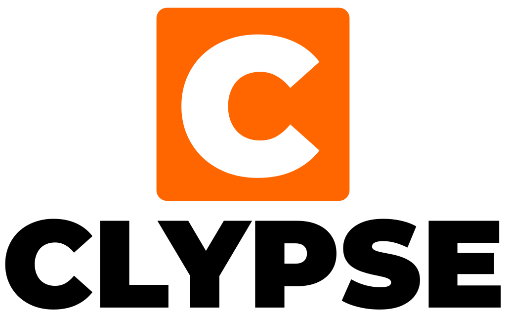
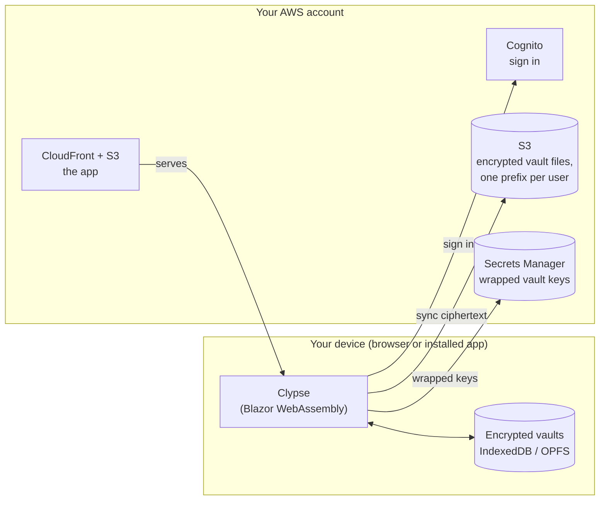

<p align="center">
  
</p>

<p align="center">
  <strong>A password manager that keeps your secrets encrypted end to end, works offline, and syncs between your
  devices through your own AWS account.</strong>
</p>

---

Clypse keeps your logins, AWS keys and other secrets in **vaults**. Each vault has its own passphrase and its own
encryption keys. Everything is encrypted in your browser before it is saved or synced, so neither the cloud storage nor
anyone with access to the AWS account can read it.

It runs in the browser and installs as an app (a PWA) on desktop and phone. It keeps working offline, and syncs your
encrypted vaults through Amazon S3 when you are back online.

> **Status:** in development, not yet released. This is a complete rewrite of the original clypse, on the
> [blazwiz](https://github.com/devoctomy/blazwiz) framework.

## Features

- **Vaults**
  - As many as you like, each with its own passphrase and keys: e.g. Personal, Work, Family.
  - A vault can be renamed and described, locks itself after a time you choose (1 minute to 1 hour, or never), and
    can be deleted.
- **Secrets**
  - Logins (user name, email, website, password), AWS credentials, or anything else.
  - Each has tags, notes and a description, and you can search across them all.
  - Sensitive fields stay hidden until you show them.
- **Copying**
  - One tap copies a user name or password.
  - Passwords and secret keys are cleared from the clipboard again after 30 seconds, or a time you choose in
    Settings.
- **Password generator**
  - Random passwords: length and kinds of character.
  - Memorable ones built from words, with your own templates.
- **Strength meter**
  - Estimates how strong a password is as you type.
  - Warns if it is one of over five million commonly used passwords.
- **Import** from KeePass and Cachy CSV exports.
- **Biometric unlock**
  - Unlock a vault with your fingerprint or face on a device you have chosen, through your passkey.
  - The vault then opens straight from the vault list.
- **Works offline**
  - Vaults are kept on each device, encrypted, and can be unlocked and used without a connection.
  - Changes sync when you are back online. A vault is synced before it is unlocked, so it is up to date.
- **Installable**: add it to your home screen or desktop. It has light and dark themes, and works at phone width.

## How your data is protected

| | |
|---|---|
| **Encrypted on your device** | Every secret, and each vault's name and description, is encrypted with AES-256-GCM in the browser before it is stored or synced. |
| **Your passphrase** | It never leaves the device. It is turned into a key with Argon2id (512 MiB of memory, 2 iterations), which makes guessing it slow and expensive. |
| **Keys** | Each vault's keys are kept in your own AWS Secrets Manager secret, wrapped with your passphrase, so they are useless without it. |
| **Nothing readable in storage** | In S3 and in the browser, a vault's files are ciphertext with random names. Names, websites and user names never appear in a file name or a path. |
| **Biometrics** | Optional, per vault and per device. The vault's key is kept on that device only, wrapped with a key that only your passkey can produce after your fingerprint, face or PIN. It is never synced. |
| **Locking** | A locked vault's keys are wiped from memory. Vaults lock on their own when idle, when you sign out, and in every open tab at once. |
| **Sign in** | Amazon Cognito, using SRP, so your account password is not sent to the server. Optionally remembered with a passkey. |
| **The page itself** | Served with a Content Security Policy that only lets it run its own code and talk to its own AWS endpoints. |

> **There is no recovery.** If you forget a vault's passphrase, its secrets cannot be decrypted by anyone, including
> you. Clypse says so when you create a vault.

## How it works



- **The app** is a static Blazor WebAssembly app, compiled ahead of time, served from S3 through CloudFront. There is
  no application server: the code runs in your browser.
- **Your data** syncs straight from the browser to S3, with temporary AWS credentials that Cognito gives the signed-in
  user. They only reach that user's own folder in S3 and their own secrets in Secrets Manager.
- **A vault** is a set of encrypted files: one for its name and description, and one for each secret, named by a
  random id. Each device keeps a copy and syncs it. When the same secret is changed on two devices, the newest change
  wins for now.
- **The framework.** Sign in, sync, end to end encryption, the app shell and Settings come from
  [blazwiz](https://github.com/devoctomy/blazwiz). The password manager itself is clypse's code.

## Run it locally

You need the [.NET 10 SDK](https://dotnet.microsoft.com/download) and its `wasm-tools` workload
(`dotnet workload install wasm-tools`).

```powershell
dotnet run --project Clypse.Portal
```

Open <http://localhost:5090>. Without AWS settings it uses a placeholder sign in (any user name and password) and keeps
vaults in the browser only, which is enough to try everything except sync between devices.

## Deploy your own

Clypse deploys to your own AWS account: CloudFront, S3, Cognito and Secrets Manager, in two CloudFormation stacks.
You can deploy two ways:

- **From your machine,** with `cloudformation/deploy.ps1`.
- **From GitHub,** with the Deploy, Upgrade and Destroy workflows. They only deploy a commit that has passed the
  tests. The Release workflow tags a commit of main as a checkpoint (`v<version>`, with a GitHub release noting the
  blazwiz version it is built on); nothing is published, deployments are always made from source.

See [`cloudformation/README.md`](cloudformation/README.md) for the steps, the IAM permissions needed, and setting up
GitHub.

## Development

| Project | What it is |
|---|---|
| `Clypse.Core` | The password manager's domain: the secret model, password generation and strength, word and password lists, CSV import. |
| `Clypse.Portal` | The app: pages, components, styles and configuration. |
| `Clypse.Portal.Application` | Vaults, secrets, copying, settings, and the view models behind every page. |
| `Clypse.Portal.Models` | Models and settings. |
| `*.UnitTests`, `Clypse.Portal.UITests` | Unit tests (xUnit), and end to end tests in a real browser (Playwright). |

```powershell
dotnet build Clypse.slnx
dotnet test Clypse.slnx --filter "FullyQualifiedName~UnitTests"
dotnet test Clypse.slnx --filter "FullyQualifiedName~UITests"   # starts the app itself
```

The first time, install the browser for the UI tests:
`pwsh Clypse.Portal.UITests/bin/Debug/net10.0/playwright.ps1 install chromium`.

The rules the code follows, and how to build against a local copy of blazwiz, are in [AGENTS.md](AGENTS.md). The
rewrite's plan and decisions are in [`docs/plans`](docs/plans).

## License

[MIT](LICENSE). clypse is built on [blazwiz](https://github.com/devoctomy/blazwiz), which is licensed under the [Apache License 2.0](https://www.apache.org/licenses/LICENSE-2.0).
